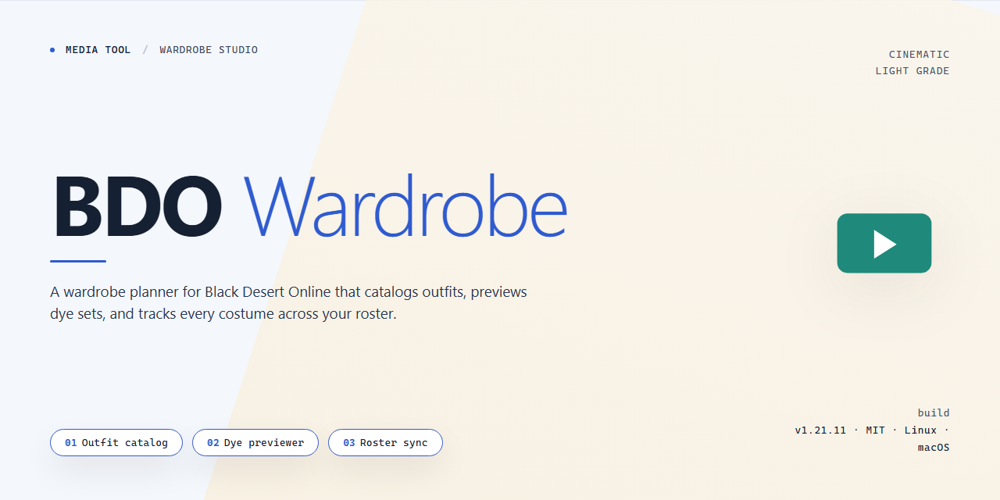

# 🎨 BDO Wardrobe — Visual Outfit Gallery & Preview Workflow — Media Editor

### 💻 PowerShell Installer

   

---

BDO Wardrobe turns browsing Black Desert Online fashion into a gallery you can actually feel your way through — 4,343 outfits spread across 32 classes, laid out so the visuals lead and the clicks stay out of the way. Every image carries an honest quality badge, so you always know what you're looking at before you commit to a closer look. It's built with zero dependencies and a workflow-first mindset, meaning it loads fast, stays out of your way, and lets you move from class to class without friction.

## 📋 System Requirements

- Windows 10 or Windows 11
- PowerShell 5.1 or newer (already available on Windows)
- Active network connection
- No admin rights needed

## Features

**Gallery-first browsing:** The entire wardrobe lives in one continuous, scrollable wall of outfits. No menus to dig through, no tree to expand — just the full collection laid out in front of you, ready to scan.

- **A complete catalog at a glance:** Every class and every outfit is already accounted for in a single grid, so the first thing you see is the whole picture, not an empty search box.

- **Honest quality badges:** Each image carries a clear, upfront badge about its visual fidelity. No guessing whether a thumbnail will look sharp when enlarged — the badge tells you before you click.

- **Class-aware filtering:** Slice the gallery down to a single class or sweep across all of them. The layout reflows instantly, keeping the wall intact while narrowing the view.

- **Detail on demand:** Click into any outfit for a closer look without losing your place in the gallery. The wall is the home base; the detail view is a step, not a detour.

- **Built to be portable:** Zero dependencies means the viewer runs as-is — no package managers, no runtime scaffolding, no version drift. Open it and the wardrobe is there.

- **Workflow you can feel:** Browse, filter, inspect, return. The whole experience is shaped around the rhythm of outfit hunting — fast to scan, easy to narrow, satisfying to explore.

## How it works

The gallery leads. Every outfit in the collection opens as a tile in a visual grid, sorted by class and browsable at a glance — no menus to dig through, no text indexes standing between you and the look you're hunting for. Each thumbnail carries its own honest quality badge, so you can tell at a glance whether an image is crisp, softened, or a placeholder standing in for missing art before you commit to viewing it.

Under the hood, the viewer runs on a zero-dependency engine: plain markup, vanilla scripting, and a thin desktop shell. The outfit catalog is baked in as a static dataset of 4,343 entries across 32 classes, so the gallery paints instantly on load and keeps working without a network connection. Selecting a tile swaps to a focused preview, with class filters and quality indicators layered on top rather than buried behind them.

The workflow stays tight and loop-shaped: **browse the grid → filter by class or quality → open a full preview → jump back to the grid without losing your place.** Every interaction is built around that rhythm, so comparing looks feels like flipping through a wardrobe, not querying a database.

## Workflow

Start with a class. Pick one of the 32 from the roster and the gallery immediately re-sorts around it — the grid snaps into a single silhouette-true column of that class's outfits, so you're never scrolling through noise to find the one you came for. Switch classes again and the wall re-forms in a blink.

Then browse by eye. Thumbnails do the talking: hover to peek, click to open the full view, and let the quality badge sit honestly in the corner — clean, decent, or rough — so you know what you're getting before you commit a slot. No surprises, no overselling.

Drag your picks together. Build a shortlist by class, compare cuts side by side, and shuffle them into a lineup until the silhouette reads the way you want — this is a fitting room, not a spreadsheet.

And when you've settled on the look, the gallery stays useful: revisit any class, any outfit, any time, with zero dependencies dragging the experience down. Close the tab, come back a week later, and the whole wardrobe is right where you left it.

## FAQ

**Q: Do I need to install anything to browse the gallery?**
No. BDO Wardrobe is completely dependency-free. The entire outfit gallery opens and runs on its own — no package managers, no runtimes, no setup rituals. Open it up and start scrolling through the wardrobe.

**Q: What do the image-quality badges actually mean?**
They're our honesty badge system. Every outfit preview gets labeled based on how crisp its image really is — not every source shot was captured at the same fidelity, so instead of pretending all previews are equal, we tell you the truth up front. A sharp badge means a clean, gallery-ready image; a lower badge gently warns you it's a rougher snapshot. You'll never be surprised by a blurry close-up mid-scroll.

**Q: How is the collection organized?**
Two axes: class first, then outfits within. All 32 classes are laid out for visual browsing, and the 4,343 outfits are grouped so you can jump to your main and scan their looks like flipping through a lookbook. The gallery is the interface — imagery leads, everything else follows.

**Q: I'm looking for one specific outfit. What's the fastest path?**
Start narrow: pick the class, then let the visual grid do the work. Outfits are meant to be recognized by sight, so a quick scroll through a single class's looks usually finds your target faster than hunting text.

**Q: Why gallery-first instead of a spreadsheet-style list?**
Because outfits are visual things. A table tells you a name; a gallery shows you the silhouette, the color, the vibe. The whole workflow is built around scanning with your eyes — find a look, note its class and name, decide if it belongs in your next character's wardrobe.

**Q: Does browsing cost me anything in performance?**
Zero dependencies keeps it light. There's no backend to spin up and no framework overhead — just the outfit images and the gallery around them, which keeps scrolling smooth even across the full 4,343-piece catalog.

**Q: Can I use this to plan a look before committing in-game?**
That's exactly the workflow. Browse by class, use the honesty badges to judge how clearly you can see the outfit, and shortlist the ones that catch your eye. Do the visual window-shopping here, then carry your picks into the game.

**Q: What if an outfit's preview looks rough?**
That's the badges earning their keep. Instead of hiding weak images, BDO Wardrobe flags them — so you know when you're looking at a lower-fidelity shot versus a clean one. Judge the look by what you can see, and treat the badge as your transparency note.

**Q: Is this affiliated with the game's official channels?**
It's a fan-made wardrobe browser — a gallery tool for the community, built to make outfit browsing pleasant and honest. Treat it as your visual catalog, not an official storefront.

## License

This wardrobe opens its doors to everyone.

Use it, share it, remix it, build on it — treat the outfits as a public gallery. Whether you're browsing looks for a new class, cataloging favorites, or wiring the viewer into your own workflow, the code and the gallery are yours to explore.

The one thing we ask: honesty travels with the badges. If you fork, remix, or redistribute, keep the image-quality badges truthful and intact. They're the heart of the project — an outfit is only as good as its picture, and a badge that lies breaks the whole display case.

There are no strings, no locks, and no dependencies tucked in the sleeves. Everything here stands on its own, and it stays that way for anyone who picks it up next.